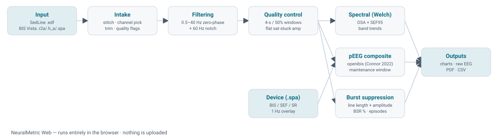
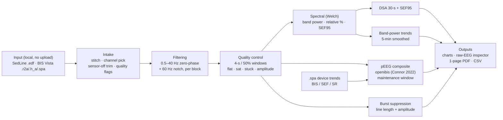

# NeuralMetric Web

A free, open, **browser-based processed-EEG (pEEG) reviewer** for perioperative frontal EEG.
It reads **Masimo SedLine EDF** and **BIS Vista raw exports**, runs the full analysis
**entirely in your browser** (nothing is uploaded), and shows a depth composite, spectrogram,
band-power trends and burst suppression — with a one-page printable report and a CSV export.

> **Educational and research use only.** Not a medical device; do not use for clinical
> decisions alone — always combine with other clinical signs and monitoring parameters.

---

## What the pipeline does

Mermaid source (editable)

| Step | Method | Why |
|---|---|---|
| **Input** | Read locally in the browser. **SedLine**: EDF, a frontal channel (e.g. `EEG R1(Fp2)`). **BIS Vista**: raw export — `.r2a` int16 interleaved + `.h_a` 2048-byte header (`µV = (AD − offset) × gain`) + `.spa` 1-Hz variables. | Runs fully client-side; no recording ever leaves the device (privacy, offline). |
| **Intake** | Multi-file stitch by clock; selectable frontal channel; sensor-off trimming; quality flags (resolution/gain change, sampling-rate change, amplifier clipping / lead-off); EDF+ annotations parsed as events. | One continuous, labelled signal, with data caveats surfaced before interpretation. |
| **Filtering** | Zero-phase 4th-order Butterworth band-pass **0.5–40 Hz** + **60 Hz** notch (Q 30), applied separately to each continuous block. | Zero phase preserves waveform timing; filters never run across a gap. |
| **Quality control** | 4-s windows, 50 % overlap; reject flat (SD < 0.5 µV), saturated (A/D rail), stuck (≥ 1 s identical), amplitude (> 150 µV). | Only clean epochs feed the metrics; every rejection is traceable. |
| **Spectral (Welch)** | PSD on QC-valid Hann windows; absolute band power δ 0.5–4, θ 4–8, α 8–12, β 12–30 Hz (µV²), relative %, and SEF95. | Standard qEEG features of anaesthetic depth. |
| **Density spectral array** | 30-s median PSD of valid windows, dB re µV²/Hz, 0.5–30 Hz, with the **SEF95** line overlaid. | Time–frequency overview with the spectral edge. |
| **Band-power trends** | Per-30-s band power, 5-min power-domain smoothing for display; absolute (dB) or relative (%). | Readable band dynamics across the case. |
| **pEEG composite** | Open reimplementation of the **openibis** depth index (Connor 2022), 0–100; automatic maintenance-window detection with a manual-window fallback. | A transparent, non-proprietary depth index — **not** BIS, not a cleared device. |
| **Burst suppression** | Line-length + amplitude detector (Särkelä 2002): line length ≤ 40 µV over 0.28 s **and** \|amp\| ≤ 5 µV for ≥ 1 s; saturated/stuck samples indeterminate. | BSR %, episode stats and a per-minute trend from a traceable rule. |
| **Device trends (BIS)** | `.spa` BIS / SEF / SR at 1 Hz, overlaid on the composite. | Compare the monitor's own index against the open composite. |
| **Outputs** | Interactive charts, click-to-inspect raw-EEG strip, one-page printable **PDF** report, wide **CSV** (one row per session), bilingual methodology page. | Review, export and teach. |

---

## Validation

The analysis engine is a Python port of the desktop **NeuralMetricsCore** and is validated
**bit-exact** against it: composite, DSA, band-power trends, burst suppression and SEF95 match
to the digit on shared inputs. The BIS Vista reader is validated **bit-exact** against the
vendor reader via an open-source reference (max difference ≈ 0 µV).

## Supported inputs

- **Masimo SedLine** — EDF / EDF+ (one frontal channel; EDF+ annotations shown as events).
- **BIS Vista** — raw USB export: `.r2a` (or `.r4a`/`.r1a`) + `.h_a` + `.spa`.

The frontal channel is selectable for both. Mains notch is 60 Hz (50 Hz planned as a setting).

## How it runs

- **Blazor WebAssembly (.NET)** front end; dependency-free SVG/canvas charts.
- **Python engine** (NumPy/SciPy) executed with **Pyodide** in a Web Worker.
- Everything is static and client-side — host it anywhere, works offline after load.
- Interface in **English and Spanish**.

## References

1. Connor CW. *Open Reimplementation of the BIS Algorithms for Depth of Anesthesia.* Anesth Analg. 2022;135(4):855–864.
2. Särkelä M, et al. *Automatic Analysis and Monitoring of Burst Suppression in Anesthesia.* J Clin Monit Comput. 2002;17(2):125–134.
3. Purdon PL, Sampson A, Pavone KJ, Brown EN. *Clinical Electroencephalography for Anesthesiologists: Part I.* Anesthesiology. 2015;123(4):937–960.
4. Rampil IJ. *A Primer for EEG Signal Processing in Anesthesia.* Anesthesiology. 1998;89(4):980–1002.
5. Welch PD. *The Use of Fast Fourier Transform for the Estimation of Power Spectra.* IEEE Trans Audio Electroacoust. 1967;15(2):70–73.
6. BIS Vista raw-export reader (binary layout, validated bit-exact vs the vendor tool). *GitHub: Tiakat/intraop-eeg-pipeline*, 2024.

## License

Released under the **MIT License** for educational and research use. See [`LICENSE`](LICENSE).
